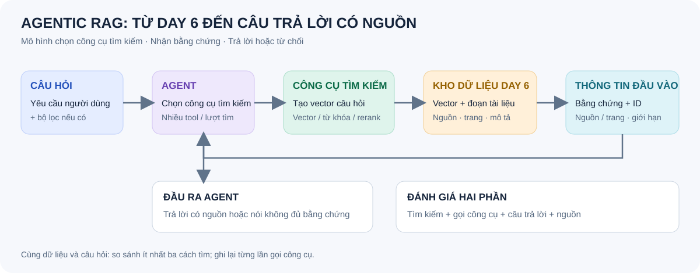
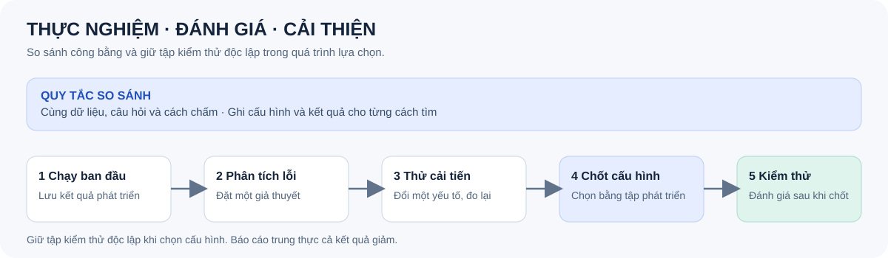

# Day 7 — Agentic RAG

> ## Bài làm: Phạm Đức Vinh · 2A202603849 · L3B — Agentic RAG trên Thông tư 91/2026/TT-BTC
>
> Báo cáo: [report/individual/2A202603849_PhamDucVinh.md](report/individual/2A202603849_PhamDucVinh.md) · Nhật ký thử nghiệm: [results/experiments.md](results/experiments.md) · Danh sách task: [task.md](task.md) · Phần đề bài gốc nằm bên dưới.
>
> | Thành phần | Lựa chọn |
> |---|---|
> | Corpus | Day 6: Thông tư 91/2026/TT-BTC, trang 1–32 (OCR), chunk A 235 · B 275 |
> | Embedding / vector store | Day 6: `paraphrase-multilingual-MiniLM-L12-v2` (384 chiều, local) · PostgreSQL 16 + pgvector 0.8.7 (Docker, cổng 55433) |
> | Agent model | GLM qua z.ai (OpenAI-compatible, tool calling), `temperature=0`; model thực tế trong trace: `glm-5.3-flash` |
> | Retrieval | dense (pgvector) · BM25 · hybrid RRF; cải thiện: ghép chunk liền kề ±1, câu hỏi gốc ở lần search đầu |
> | Cấu hình đã chọn | `bm25_A_nb`: BM25 + chunk liền kề, top-k 3, budget 6000 ký tự, ≤ 3 search |
> | Kết quả test (đã chọn so với dense) | Context Evidence Rate 5/5 vs 2/5 · grounded 2,00 vs 0,60 /2 · từ chối nhầm 0/5 vs 3/5 |
>
> ### 1. Cài đặt (một lần; Git Bash/UCRT64 — PowerShell dùng `.venv\Scripts\Activate.ps1`)
>
> Cần Python 3.11+ (đã chạy 3.13), Docker, và kết quả Day 6 ở `../../Day6/K5-L3B-Day06-DataIngestionEngineering` (database pgvector đã ingest).
>
> ```bash
> python -m venv .venv && source .venv/Scripts/activate
> python -m pip install torch --index-url https://download.pytorch.org/whl/cpu
> python -m pip install -r requirements.txt
> cp .env.example .env        # rồi điền ZAI_API_KEY (không commit .env)
> export PYTHONUTF8=1         # bắt buộc trên Windows: file JSON tiếng Việt, test của đề đọc file không chỉ định encoding
> ```
>
> ### 2. Bật vector store Day 6 (mỗi lần khởi động máy)
>
> ```bash
> docker compose -f ../../Day6/K5-L3B-Day06-DataIngestionEngineering/starter/docker-compose.yml -p day6_student_starter up -d --wait
> python -m src.check_dense            # kỳ vọng: A 235, B 275 chunk, có kết quả trang 4
> ```
>
> ### 3. Chuẩn bị dữ liệu (đã có sẵn trong `data/`; chỉ chạy lại khi DB Day 6 thay đổi)
>
> ```bash
> python -m src.export_chunks          # data/chunks_A.json (235), data/chunks_B.json (275)
> python -m src.convert_questions      # data/questions.json: 20 câu (15 dev / 5 test); báo A: d12, t04 · B: d08 không hit được
> python -m src.build_cases            # data/cases.json: 24 câu (dev 15+2, test 5+2)
> python -m src.search_corpus "phạt" "thời hạn lưu"   # kiểm tra câu thiếu bằng chứng (0 kết quả)
> ```
>
> ### 4. Retrieval (không dùng LLM, chi phí 0)
>
> ```bash
> python -m src.eval_retrieval --split dev --strategy A B                         # dense, bm25, bm25+bigram, hybrid
> python -m src.eval_retrieval --split dev --strategy A --methods dense bm25 bm25+nb
> python -m src.eval_retrieval --split test --locked --strategy A --methods dense bm25+nb   # chỉ sau khi chốt
> ```
>
> ### 5. Agent (gọi API z.ai, ~25 s/câu)
>
> ```bash
> # dev — 3 phương pháp
> python -m src.run_agent --name dense_A  --retriever dense  --strategy A --split dev
> python -m src.run_agent --name bm25_A   --retriever bm25   --strategy A --split dev
> python -m src.run_agent --name hybrid_A --retriever hybrid --strategy A --split dev
> # dev — 2 cải thiện + kết hợp
> python -m src.run_agent --name bm25_A_nb      --retriever bm25   --strategy A --split dev --neighbors 1 --budget 6000
> python -m src.run_agent --name dense_A_oq     --retriever dense  --strategy A --split dev --first-query original
> python -m src.run_agent --name hybrid_A_oq_nb --retriever hybrid --strategy A --split dev --first-query original --neighbors 1 --budget 6000
> python -m src.eval_agent --split dev dense_A bm25_A hybrid_A bm25_A_nb dense_A_oq hybrid_A_oq_nb
> # test — chỉ baseline và cấu hình đã chọn (results/selection.json), chạy 1 lần
> python -m src.run_agent --name dense_A   --retriever dense --strategy A --split test --locked
> python -m src.run_agent --name bm25_A_nb --retriever bm25  --strategy A --split test --locked --neighbors 1 --budget 6000
> python -m src.eval_agent --split test dense_A bm25_A_nb
> ```
>
> Chạy thử 1–2 câu: thêm `--ids d03 d16`. Chạy lại sẽ ghi đè trace cũ và cho kết quả hơi khác (model API không tất định).
>
> ### 6. Chấm tay và tổng hợp
>
> ```bash
> python -m src.eval_agent --split test --review bm25_A_nb        # tạo reviews_test.json trống (không ghi đè nhãn đã có)
> python -m src.grade results/agent/bm25_A_nb/reviews_test.json   # chấm trong terminal; --redo <id> để chấm lại
> python -m src.fill_labels                                       # hoặc: ghi lại đúng nhãn chính thức đã nộp
> python starter/agent_metrics.py --cases data/cases.json --traces results/agent/bm25_A_nb/traces_test.json \
>   --reviews results/agent/bm25_A_nb/reviews_test.json --split test --output results/agent/bm25_A_nb/agent_metrics_test.json
> python -m unittest discover -s tests -v                         # 25 test
> ```
>
> ### Bản đồ file
>
> | Đường dẫn | Nội dung |
> |---|---|
> | `src/embeddings.py`, `src/store.py`, `src/models.py` | Copy nguyên từ Day 6 (embedding, pgvector) |
> | `src/retrieval.py` | Dense, BM25, hybrid RRF, cửa sổ chunk liền kề |
> | `src/agent.py`, `prompts/agent_system.md` | Controller GLM (tool calling) cho `starter/agentic.py` `run_agent` (không sửa) |
> | `src/run_agent.py`, `src/eval_retrieval.py`, `src/eval_agent.py` | Chạy agent + lưu trace; benchmark retrieval; so sánh cấu hình, tạo file chấm |
> | `src/grade.py`, `src/fill_labels.py` | Công cụ chấm tay; nhãn chính thức |
> | `data/` | Chunk export, 20 câu có đáp án (`questions.json`), 24 câu agent (`cases.json`) |
> | `results/selection_criteria.md`, `results/selection.json` | Tiêu chí chốt trước khi chạy; cấu hình đã chọn |
> | `results/retrieval/` | Hit@k, MRR, top-10 + cờ hit từng câu |
> | `results/agent/<cấu hình>/` | `config.json`, `traces_*.json`, `reviews_*.json` (nhãn), `agent_metrics_*.json` |
> | `results/agent/grades_{dev,test}.md` | Bảng nhãn + lý do (AI chấm nháp, người chấm chấp nhận — xem báo cáo) |


**Bài cá nhân · Python 3.11+ · tiếp nối Day 6**

Dùng embedding và vector store từ Day 6 để xây một agent biết tìm bằng chứng, trả lời có nguồn và nhận biết khi không đủ thông tin. Bạn tự chọn kiến trúc, số tool và cách tổ chức retrieval.

> **Tùy chọn:** [Gợi ý dùng AI để lập trình](AGENT_SETUP.md) giúp bạn làm lab; phần này không bắt buộc và không tính điểm.

## Bài cần làm



1. Kết nối dữ liệu, embedding và vector store Day 6.
2. Xây agent dùng model thật và ít nhất một khả năng truy xuất dữ liệu. Agent có thể dùng nhiều tool và nhiều lượt gọi.
3. Thử **ít nhất 3 phương pháp retrieval khác nhau**, trong đó có dense retrieval dùng vector store Day 6. Tự chọn các phương pháp còn lại; xem [gợi ý](GUIDE.md#2-thử-các-phương-pháp-retrieval).
4. Thử nhiều cấu hình, benchmark, phân tích lỗi và chọn cấu hình tốt trên **dev**; sau đó đánh giá trên **test**.

Benchmark tối thiểu có **24 câu**: dev gồm 15 câu có đáp án và 2 câu thiếu bằng chứng; test gồm 5 câu có đáp án và 2 câu thiếu bằng chứng. Xem [benchmark](BENCHMARK.md) và [rubric](RUBRIC.md).

## Thử thách nâng cao · +15 điểm

Index một tài liệu thực tế từ **100 trang** có bảng, ảnh và biểu đồ; xây agent truy xuất và trả lời các câu hỏi về nội dung đó. Hoàn thành [thử thách nâng cao](ADVANCED.md) và đạt **ít nhất 90% benchmark test** để nhận 15 điểm bonus. Phần cơ bản tối đa 85 điểm; toàn bài tối đa 100 điểm.

## Bắt đầu

1. Đọc [hướng dẫn](GUIDE.md), [rubric](RUBRIC.md) và [quy tắc](RULES.md).
2. Tạo repo cá nhân theo [cách nộp bài](SUBMISSION.md), chuẩn bị đầu ra Day 6 và model hỗ trợ tool calling.
3. Dùng hoặc thay thế [starter](starter/README.md); bạn cần kết nối model và vector store thật.
4. Chạy `python -m unittest discover -s tests -v`. Test mock chỉ kiểm tra code, không phải benchmark agent thật.



Nộp code, cách chạy, cấu hình, benchmark, trace và [báo cáo](report/individual/MSSV_HoTen.md). Thời gian ở [checkpoints](CHECKPOINTS.md) là gợi ý, có thể điều chỉnh theo lớp và phạm vi thử nghiệm.
